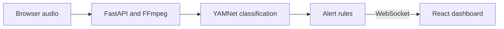

# SENTINEL

**An acoustic incident dashboard for community safety.**

In a busy residential area, a distress scream or a crash can blend into everyday noise. SENTINEL is a team hackathon prototype that shows how a microphone can flag a potential incident for human review. It classifies short audio clips, filters repeat alerts, and sends selected events to a dashboard where someone can review and update them.

## See it in action

1. Open the dashboard to explore the incident feed, map, and volunteer panel. The dashboard starts with sample incidents, so you can try the review workflow before using a microphone.
2. Open **Audio Classifier** and upload a WAV clip using the [test bench guide](SENTINEL/testbench/TESTING_GUIDE.md). Look at the predicted sound classes and their confidence scores.
3. Enable **Live Demo** and allow microphone access to try live classification. Eligible events can appear in the incident feed. Review an incident, then try updating its status.

To confirm you are demonstrating real inference, check [backend health](http://localhost:8000/health) for `classifier_available: true` and `model_loaded: true`. The backend can return mock classifications when the classifier import fails.

## How it works



| Stage | What happens |
| --- | --- |
| Audio capture | The browser accepts an audio upload or records short microphone chunks. The live endpoint uses FFmpeg to convert those chunks to 16 kHz mono WAV. |
| Classification | YAMNet scores sound classes. The classifier applies a watchlist and confidence thresholds to decide which sounds warrant attention. |
| Alerting | The backend broadcasts eligible events with a severity level and suggested response. A global cooldown and per-sound rules limit repeated alerts. |
| Review | The browser receives incident events over a WebSocket. The dashboard shows an incident feed and map, with sample data for location and volunteer workflows. |

A [Raspberry Pi sensor prototype](SENTINEL/edge/pi_sensor.py) demonstrates a second capture path that sends audio to the backend for classification.

**Built with** Python, FastAPI, TensorFlow Hub, YAMNet, FFmpeg, React, Leaflet, and WebSockets.

## My contribution

I contributed to the Python classifier and the backend rules that decide when to show an incident. I tuned how medium-severity predictions are filtered by confidence and adjusted the cooldowns for repeated alerts. The aim was to keep the incident feed usable when a microphone sends successive chunks containing the same sound. [Classifier and alerting changes](https://github.com/Lilwaizy10/SENTINEL/commit/3defdde7febbd7f13c0b999bfba2ab8f439c9fa7)

## Run locally

Install Python 3.11, Node.js with npm, and FFmpeg. Make sure `ffmpeg` is on your PATH for live microphone classification. The backend may need internet access on first launch to load the YAMNet model and class map.

From the repository root, start the backend in one terminal:

```sh
cd SENTINEL/backend
python -m pip install -r requirements.txt
python -m uvicorn main:app --reload --port 8000
```

From the repository root, start the frontend in a second terminal:

```sh
cd SENTINEL/frontend
npm ci
npm start
```

Open the [dashboard](http://localhost:3000). The [FastAPI docs](http://localhost:8000/docs) list the routes available in the running backend.

## Validation and limitations

- The [testing guide](SENTINEL/testbench/TESTING_GUIDE.md) covers uploaded audio, the live microphone, WebSocket events, and dashboard interactions. It provides a checklist for evaluating the prototype. Detection accuracy, false-alert rates, and alert latency have yet to be established for real residential settings.
- The browser and Raspberry Pi workflows send audio to the configured backend. Live microphone chunks are written to temporary files for conversion, and the endpoint attempts to remove them after processing.
- Suggested responses and simulated volunteer data demonstrate the review workflow. Use SENTINEL for local evaluation and demos only.

[Backend](SENTINEL/backend/) · [Frontend](SENTINEL/frontend/) · [Edge sensor](SENTINEL/edge/) · [Testing guide](SENTINEL/testbench/TESTING_GUIDE.md)
